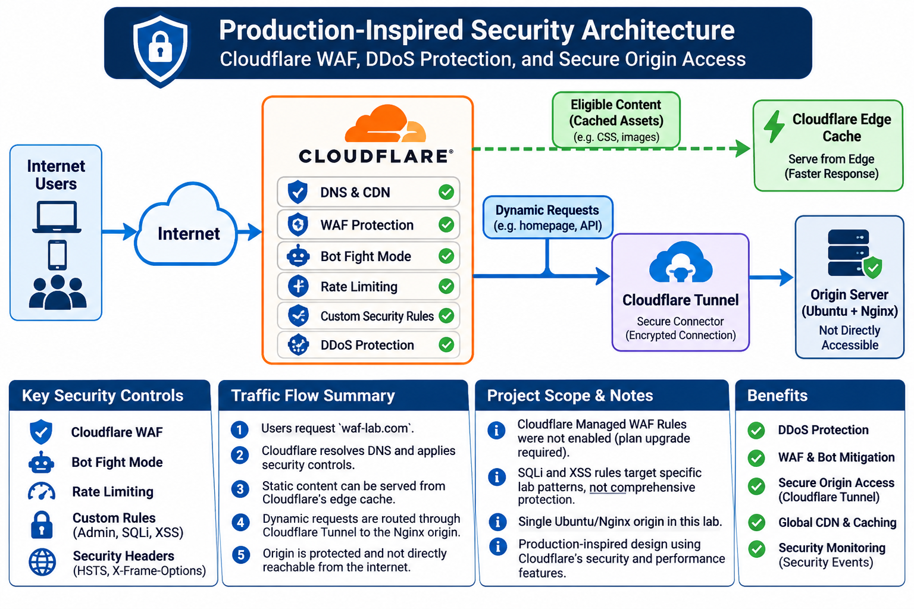

# NorthStar Enterprise Portal — Cloudflare Infrastructure & Security Project
## Project Overview
This project demonstrates the deployment and security hardening of a web application using Cloudflare, Cloudflare Tunnel, Ubuntu Server, and Nginx.

The objective was to build an enterprise-style web application environment with secure public access, protected origin infrastructure, edge security controls, traffic management, caching, and security monitoring.

The application is hosted on an Ubuntu Server virtual machine running Nginx. Cloudflare Tunnel provides secure connectivity between the Cloudflare network and the private origin server without exposing the origin through a publicly accessible inbound web port.

## Project Objectives
- Deploy a web application on an Ubuntu Server virtual machine.

- Configure a custom domain and Cloudflare DNS proxy.

- Establish secure origin connectivity using Cloudflare Tunnel.

- Restrict direct access to the origin server.

- Implement custom Cloudflare security rules.

- Configure rate limiting and Bot Fight Mode.

- Apply HTTP security headers.

- Configure and validate static asset caching.

- Monitor and investigate security events.

- Document the architecture, implementation, and test results.

## Environment
| Component | Implementation |

|---|---|

| Domain | waf-lab.com |

| DNS and Edge Security | Cloudflare |

| Tunnel | Cloudflare Tunnel |

| Tunnel Connector | cloudflared |

| Origin Operating System | Ubuntu Server |

| Web Server | Nginx |

| Virtualization | VMware |

| VM Network | NAT |

| Host Firewall | UFW |

| Application | NorthStar Enterprise Portal |

## Architecture and Traffic Flow


### High-Level Architecture
```text

                    Internet Users

                          |

                          | HTTPS

                          v

                 Cloudflare DNS / Proxy

                          |

                          v

                 Cloudflare Edge Network

                 -----------------------

                 - TLS / HTTPS

                 - Custom Security Rules

                 - Rate Limiting

                 - Bot Fight Mode

                 - Static Asset Caching

                 - Security Event Monitoring

                          |

                          | Encrypted Tunnel

                          v

                  Cloudflare Tunnel

                     cloudflared

                          |

                          | HTTP over loopback

                          v

                   Ubuntu Server VM

                       127.0.0.1:80

                          |

                          v

                       Nginx

                          |

                          v

              NorthStar Enterprise Portal

```

### Request Flow
1. A user accesses `https://waf-lab.com` or `https://www.waf-lab.com`.

2. Cloudflare DNS resolves the hostname to Cloudflare's proxied edge network.

3. The request reaches Cloudflare, where applicable security and traffic controls are evaluated.

4. Cloudflare evaluates applicable security controls and serves eligible cached content from its edge when available. Requests requiring origin content are forwarded through Cloudflare Tunnel.

5. The `cloudflared` connector forwards the request to Nginx on the Ubuntu VM through the local loopback interface.

6. Nginx serves the NorthStar Enterprise Portal.

7. The response returns through the Tunnel and Cloudflare to the user.

### Origin Protection
- Nginx listens on `127.0.0.1:80` rather than a publicly reachable network interface.

- UFW is configured with default-deny incoming traffic.

- SSH access is restricted to the local network.

- Public web traffic reaches the origin through Cloudflare Tunnel.

- No inbound public HTTP port-forwarding is required.

## Security Implementation
### 1. Cloudflare Custom Security Rules
Three custom rules were implemented and tested.

| Rule | Purpose | Test Result |

|---|---|---|

| Block-Admin-Path | Blocks requests to `/admin` | HTTP 403 |

| Block-SQLi-Test | Blocks a targeted encoded SQL injection test pattern | HTTP 403 |

| Block-XSS-Test | Blocks a targeted encoded script-tag test pattern | HTTP 403 |

Legitimate query-string requests were also tested and returned HTTP 200.

****Note:**** These are targeted lab rules. They do not provide comprehensive protection against all SQL injection or cross-site scripting attacks. A production deployment should use an appropriate managed WAF ruleset, application-layer input validation, and security testing.

### 2. Rate Limiting
A rate-limiting rule named `Protect-Portal-Rate-Limit` was configured.

| Setting | Configuration |

|---|---|

| Matching path | `/` |

| Counting characteristic | Source IP |

| Request threshold | 10 requests |

| Period | 10 seconds |

| Action | Block |

| Mitigation timeout | 10 seconds |

The rule was tested and Cloudflare Security Events showed a matching event with the action `Block`.

### 3. Bot Protection
Cloudflare Bot Fight Mode was enabled.

Security Events showed multiple `Managed Challenge` actions associated with Bot Fight Mode.

### 4. HTTP Security Headers
The following headers were configured at the Nginx origin and verified in the public HTTPS response.

| Header | Configuration | Purpose |

|---|---|---|

| Strict-Transport-Security | `max-age=31536000` | Enforces HTTPS in supporting browsers |

| X-Content-Type-Options | `nosniff` | Prevents MIME-type sniffing |

| X-Frame-Options | `DENY` | Prevents framing by other sites |

| Referrer-Policy | `strict-origin-when-cross-origin` | Controls referrer information |

| Content-Security-Policy | `default-src 'self'; frame-ancestors 'none'; object-src 'none'; base-uri 'self'` | Restricts permitted content sources and embedding |

### 5. Origin Firewall and Access Restrictions
- UFW enabled with default-deny incoming policy.

- Outbound traffic allowed.

- SSH restricted to the local subnet.

- Nginx bound to loopback only.

- Direct HTTP access to the VM from the Windows host was tested and failed as intended.

- Public application access remained functional through Cloudflare Tunnel.

## Testing and Validation
The project was validated through DNS checks, HTTP requests, security-rule tests, origin-access tests, and Cloudflare Security Events.

### 1. DNS and Tunnel Validation
| Test | Result |

|---|---|

| `waf-lab.com` DNS resolution | Cloudflare IP addresses returned |

| `www.waf-lab.com` DNS resolution | Cloudflare IP addresses returned |

| Cloudflare Tunnel service | Active and connected |

| Root hostname HTTPS access | HTTP 200 |

| WWW hostname HTTPS access | HTTP 200 |

### 2. Application Security Tests
| Test | Expected Result | Observed Result |

|---|---|---|

| Homepage request | HTTP 200 | HTTP 200 |

| `/admin` request | HTTP 403 | HTTP 403 |

| Encoded SQL injection test | HTTP 403 | HTTP 403 |

| Encoded XSS test | HTTP 403 | HTTP 403 |

| Normal `id=123` query | HTTP 200 | HTTP 200 |

| Normal `q=hello` query | HTTP 200 | HTTP 200 |

### 3. Rate-Limiting Validation
- Triggered the configured rate-limiting control.

- Confirmed a `Rate limiting rules` event in Cloudflare Security Events.

- Verified the matched rule: `Protect-Portal-Rate-Limit`.

- Observed action: `Block`.

### 4. Security Event Investigation
Cloudflare Security Events were reviewed to identify:

- Matched security rule and service.

- Action taken.

- Source IP address and ASN.

- Country classification.

- HTTP method and request path.

- Query string and User-Agent.

- Cloudflare Ray ID.

Custom-rule blocks, rate-limiting blocks, and Bot Fight Mode managed challenges were observed.

### 5. Caching Validation
| Request | First Request | Subsequent Request |

|---|---|---|

| `/lab.css` | `MISS` | `HIT` |

| `/` homepage | `DYNAMIC` | `DYNAMIC` |

The static CSS asset was successfully cached at the Cloudflare edge. The homepage remained dynamically served.

### 6. Origin Security Validation
- Nginx was confirmed listening on loopback only.

- Direct HTTP access to the origin from the Windows host failed.

- Public access to both domain hostnames continued to return HTTP 200 through Cloudflare Tunnel.

### 7. Overall Outcome
The lab successfully demonstrated secure public application delivery through Cloudflare, origin isolation using Cloudflare Tunnel, edge security enforcement, rate limiting, bot protection, HTTP security headers, static asset caching, and security event investigation.

## Limitations and Future Improvements
### Current Lab Limitations
This project is a practical security lab, not a complete production enterprise deployment.

- Custom SQL injection and XSS rules detect specific test patterns rather than all attack variations.

- Cloudflare Managed WAF Rules were not enabled because they require a plan upgrade in this environment.

- The application is a basic Nginx-hosted portal rather than a full backend application with authentication and a database.

- No centralized SIEM integration or automated alerting has been implemented.

- The lab uses a single origin server without high availability or load balancing.

- The local connection between `cloudflared` and Nginx uses HTTP over loopback.

### Future Improvements
- Deploy a managed WAF ruleset with carefully tested exclusions.

- Add Cloudflare Access to protect administrative applications.

- Implement application authentication and authorization.

- Add API security testing and request validation.

- Integrate Cloudflare security events with Wazuh or another SIEM.

- Build dashboards and alerts for security incidents.

- Introduce a second origin and load-balancing or failover design.

- Add automated security testing and configuration management.

## Skills Demonstrated
- Cloudflare DNS and proxy configuration

- Cloudflare Tunnel deployment and troubleshooting

- Secure origin architecture and network isolation

- Ubuntu Server administration

- Nginx configuration and HTTP security headers

- Firewall configuration using UFW

- Web application security testing

- Custom WAF rule creation and validation

- Rate limiting and bot protection

- CDN caching and HTTP response analysis

- Security event investigation and log interpretation

- DNS, TLS, HTTP, and end-to-end connectivity troubleshooting

## Project Summary
The NorthStar Enterprise Portal project demonstrates how Cloudflare can provide a secure public entry point for a privately hosted web application.

By combining Cloudflare's edge security capabilities with Cloudflare Tunnel, Ubuntu Server, Nginx, and host-level firewall restrictions, the project establishes a practical foundation for secure web application delivery and security operations.

The implementation and validation process provides hands-on experience with network security, application security, edge protection, traffic management, and incident investigation.

## Project Evidence

The following screenshots document the configuration and validation completed in this lab. They are stored in the `evidence/` directory.

1. [Cloudflare DNS records](evidence/01-cloudflare-dns.png)
2. [Cloudflare custom security rules](evidence/02-cloudflare-custom-rules.png)
3. [Cloudflare rate-limiting configuration](evidence/03-cloudflare-rate-limiting.png)
4. [Cloudflare Bot Fight Mode](evidence/04-cloudflare-bot-fight-mode.png)
5. [HTTP security headers](evidence/05-http-security-headers.png)
6. [Cloudflare Tunnel service status](evidence/06-cloudflare-tunnel-status.png)
7. [Cloudflare cache validation](evidence/07-cloudflare-cache-validation.png)
8. [Application security test results](evidence/08-application-security-tests.png)
9. [Cloudflare Security Events](evidence/09-cloudflare-security-events.png)
10. [Origin direct-access restriction test](evidence/10-origin-direct-access-blocked.png)
